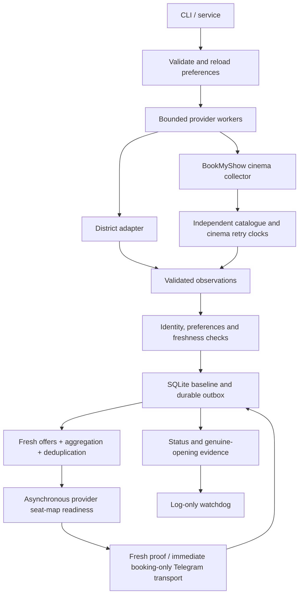

# Architecture and extension points

One monitor process owns one SQLite database. Provider jobs run in a bounded
thread pool (three workers); only the main orchestration thread writes booking
state. Verified observations are ingested as they arrive, without waiting for
an entire provider batch. No network request is performed inside a booking-state
transaction. The watchdog is a separate, log-only process.

## Modules

| Module | Responsibility |
| --- | --- |
| `cli.py`, `__main__.py` | Arguments, config/credential boundary, process lock |
| `config.py`, `core.py` | Config validation, domain records and preference matching |
| `providers/common.py` | Public-page decoding, movie/inventory validation |
| `providers/district.py` | Pure District payload-to-Show parser |
| `providers/collector.py` | District HTTP discovery and language variants |
| `bms.py` | BookMyShow cinema discovery, parsing, bounded API cache and schedules |
| `http.py`, `schedule.py` | Timeouts, response bounds, pacing and retry clocks |
| `engine.py` | Worker scheduling, live reload, ingestion and shutdown |
| `identity.py` | Canonical cinema/performance identity and trusted URL checks |
| `state.py` | SQLite transactions, baselines, offers, outbox and retention |
| `enrichment.py` | Optional provider details, strict validation and snapshot rendering |
| `readiness.py` | Passive map reads, isolated retry workers, short-lived proof and immediate wakeup |
| `delivery.py`, `notify.py` | Booking message policy and Telegram HTTP transport |
| `ports.py` | Structural collector/sender interfaces |
| `health.py`, `verification.py` | Local incidents and read-only genuine-event proof |

## Invariants

1. A failed, stale or incomplete scope never establishes a successful baseline.
2. A startup listing is silent even if its stock changes later. An initially
   blocked scope's first successful snapshot is also silent.
3. Movie + city + canonical theatre + IST start minute is the performance key.
   Database uniqueness enforces one delivery per performance/group.
4. A delivery is claimed before POST. Successful acknowledgement marks SENT;
   ambiguous network/crash outcomes become UNKNOWN and are not auto-replayed.
5. Provider/format/language metadata is validated before preference matching.
   Unknown stock is never promoted to bookable stock.
6. Only booking alerts use the bot. Health collection cannot load credentials or send.
7. Test databases/evidence cannot qualify as a genuine production opening.
8. Optional detail failures never establish stock or prevent a valid opening alert.
   Enrichment does not affect show/performance keys or preference generations.
9. Delivery requires an explicit policy: matched BookMyShow shows need successful
   map reads; District-only listings can take the user-authorized fallback when
   verification is unavailable. HTTP 200 alone is not a successful map read.
   Workers cannot write state or send messages.

The existing `v2_*` table names and key-generation algorithms are retained for
compatibility. The old single-watch Store/outbox and browser experiments were
removed; they are not another supported execution path. Outbox preparation skips
performances already queued for all requested groups using the existing unique
index, avoiding repeated offer lookups for completed deliveries.

Observation history keeps changes and hourly snapshots, with configured retention.
Show/delivery identities remain through future performances and until 90 days
after each start. HTTP payload and BookMyShow cache sizes are bounded. The
watchdog's incident journal is local operational history; automatic backups are
not configured.

## Next phase

Keep an initial web/API layer separate from polling. Validate API-created watches
through `validate_app`; publish configuration atomically rather than allowing a
web request to mutate live in-memory jobs. Preserve the current preference and
performance keys so upgrades do not replay history.

For another provider, add a parser and collector returning `Observation`/`Show`,
extend config and trusted-link validation, then wire scheduling explicitly.
Use contract fixtures for correct/wrong film, city/date substitution, sold-out,
missing stock, stale data, pagination and provider failures. No adapter should
know Telegram group IDs or write directly to the delivery outbox.

A new notification transport implements `NotificationSender.send` and preserves
acknowledged/permanent/ambiguous failure distinctions. The current delivery policy
and state transitions remain the shared boundary.

SQLite and the OS lock deliberately support one active writer, not multiple
replicas. Before horizontal scaling, move transactions/outbox to a shared database,
add worker leases/unique constraints and partition provider polling by city/movie
so users reuse fetched results. Replacing SQLite alone does not make external
Telegram delivery exactly once. Seat holds/checkout require a separately verified
provider integration; they are not an extension of an availability alert API.
