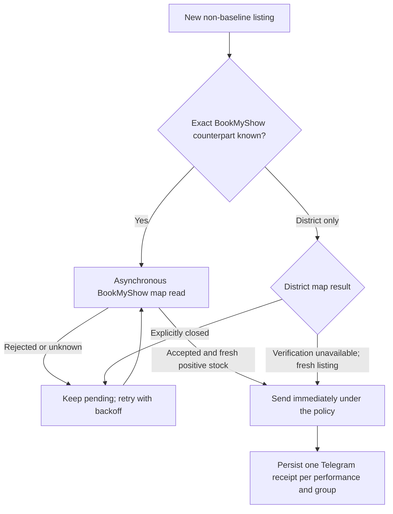

# Booking readiness before notification

The production engine applies the following user-authorized policy. Failures and
recovery remain local diagnostics, never Telegram messages.

| Listing situation | Decision |
| --- | --- |
| BookMyShow only | Require fresh positive stock and a successful BookMyShow map read |
| District and an exact matching BookMyShow show | Wait until BookMyShow passes; failed/unknown BMS verification cannot fall through to District |
| District only, District verification unavailable | Send from the fresh validated District listing |
| District explicitly rejects booking | Withhold that District offer; this is not an unavailable-verification fallback |

The District-only exception is **listing-based**, not verified seat-map access.
It may still alert for a listing whose booking page subsequently fails. This is
the coverage/verification tradeoff explicitly requested by the user.

## Timing

The first check starts when a new eligible listing is ingested. Business
rejections normally retry after **2 seconds**, independently of the normal
60-second listing poll. Success wakes delivery immediately. There is no
aggregation wait, second-success requirement or wait for another platform.
`aggregation_seconds` remains a compatibility setting and is ignored by guarded
delivery. Candidate backlogs, network latency and Telegram pacing still apply.

At most two reads per provider and four total workers keep requests bounded.
Access denials (401/403/412/429) pause that provider for 30 seconds, increasing up
to 300 seconds, or longer when Retry-After requires it. Other unknown failures
back off from 2 to 30 seconds. An existing District provider cooldown does not
add a wait to a new eligible District-only fallback. No access-control bypass,
seat selection, transaction initialization, holds or payment calls are used.

## Matching and absence

Counterparts share the canonical movie/city/theatre/date/time identity and must
also have compatible language, projection and auditorium. Room-number spelling
and the observed MS-Infinity Vsn / MS INFINITY VISION spelling are normalized
explicitly. Different movies, times, languages, known rooms and projection
dimensions cannot borrow each other's results. A missing projection dimension
requires additional matching native session identity.

`v2_bms_presence` retains validated BookMyShow listings, including unavailable
ones, across failures, disappearance from later responses and restarts. A known
matching show cannot become District-only because a later scan failed or went
empty: it must return with fresh positive stock and pass its map check. Only
active watch history applies.

For mapped theatres a fresh completed BookMyShow scope is required before absence
can authorize fallback. Failed/stale scans cannot establish absence. Unmapped
venues rely on no known counterpart; this is best-effort coverage, not proof
that BookMyShow has no differently named listing. Add reviewed aliases rather
than fuzzy-merging names. Eight current Chennai mappings have been reviewed,
including Marina Mall, PVR VR Chennai, Aerohub and INOX LUXE. Stored identities
are reconciled before delivery on startup or configuration reload.

## Map contracts and persistence

BookMyShow uses only the published initial GETSEATLAYOUT read, with transaction
identifier 0 and no selected seats or customer login. It needs the recognized
successful envelope, zero exception fields, no error text and a structurally
valid nonempty base64 payload. The encoded map remains opaque: its bytes are not
converted into inventory counts, seat adjacency or checkout guarantees. HTTP 200
with business failure, HTML or an unknown schema never passes.

District's tested map route returns HTTP 412. Its successful map contract remains
unverified. UNKNOWN can therefore take only the listing fallback above. After
matching BookMyShow succeeds, both fresh listings may appear unless District has
explicitly rejected its own map. PVR native availability is not relabelled as
aggregator-specific verification. See the [investigation](booking-readiness-investigation.md).

Workers never access SQLite or Telegram. The main thread records map results in
`v2_readiness`; BMS map proofs last **10 seconds** by default and are checked
again with listing freshness before claiming a delivery. Signatures bind the
movie/session/venue/date/language/format and request context. Pending alerts are
rechecked after restarts. Failed checks do not increment Telegram attempts or
consume a receipt. Existing baseline suppression, sent receipts, ambiguous-send
handling and late-platform deduplication remain in force.

District-only messages use the first listing time and say "First detected
available". Verified messages use the first accepted map-read time. Neither is
an exact provider-published opening timestamp. There are no health messages or
unverified numeric BookMyShow inventory counts. Missing optional details still
do not block an otherwise eligible alert; see [detail validation](alert-details.md).
